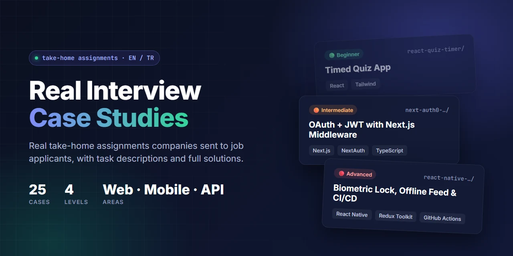

  

# Real Job Application Case Studies

🇬🇧 English | [🇹🇷 Türkçe](./README.tr.md)

  

This repo contains **real technical take-home assignments** that companies sent to job applicants, together with their solutions. The goal is to help you see the kinds of tasks you may face in a hiring process and practise them in advance.

> Company names, logos and contact details have been removed for privacy. Task descriptions were rewritten based on the originals.

## 📚 Cases

### 🟢 Beginner

| Case | Topic | Tech |
| --- | --- | --- |
| [html-css-signup-landing-page](./html-css-signup-landing-page) | Sign-up page from a Figma design | HTML, CSS |
| [react-flexbox-sorted-data](./react-flexbox-sorted-data) | Sorting JSON data and displaying it with Flexbox | React, CSS |
| [react-quiz-timer](./react-quiz-timer) | Timed quiz with a results table | React, Tailwind |
| [react-campaign-shop-ui](./react-campaign-shop-ui) | 3-page campaign / points-based shopping UI | React, Tailwind |
| [react-weather-app](./react-weather-app) | Weather dashboard UI | React, SCSS |

### 🟡 Beginner–Intermediate

| Case | Topic | Tech |
| --- | --- | --- |
| [javascript-stock-customer-crud](./javascript-stock-customer-crud) | Stock and customer CRUD | Vanilla JS, Axios |
| [react-real-estate-filter](./react-real-estate-filter) | Real estate filtering with URL parameters | React, Context API |
| [react-redux-query-ecommerce](./react-redux-query-ecommerce) | Product list and cart | React, RTK Query |
| [react-news-stock-dashboard](./react-news-stock-dashboard) | Financial news and stock search | React, json-server |
| [next-scss-ecommerce](./next-scss-ecommerce) | Categories, product details and cart | Next.js, SCSS |
| [next-crypto-exchange-landing](./next-crypto-exchange-landing) | Crypto exchange home page clone | Next.js, Tailwind |
| [next-recipe-finder](./next-recipe-finder) | Recipe search with SSR, caching and Suspense | Next.js, Tailwind |

### 🟠 Intermediate

| Case | Topic | Tech |
| --- | --- | --- |
| [react-covid-map](./react-covid-map) | World map, Redux-Saga and tests | React, Redux-Saga, Vitest |
| [react-movie-list](./react-movie-list) | Movie guide with favorites | React, TypeScript, RTK Query |
| [react-university-list-filter-login](./react-university-list-filter-login) | Filtering, sorting, pagination and login | React, json-server |
| [react-saas-admin-dashboard](./react-saas-admin-dashboard) | Animated admin dashboard | React, TypeScript, MUI, Recharts |
| [next-tailwind-travel-filter](./next-tailwind-travel-filter) | Category-based filter popup | Next.js, TypeScript, Tailwind |
| [next-mui-learning-dashboard](./next-mui-learning-dashboard) | Dashboard built on a template repo | Next.js, MUI, Jest, Cypress |
| [next-auth0-authentication](./next-auth0-authentication) | OAuth, JWT and middleware protection | Next.js, NextAuth, Auth0 |

### 🔴 Intermediate–Advanced / Advanced

| Case | Topic | Tech |
| --- | --- | --- |
| [next-i18n-seo-ecommerce](./next-i18n-seo-ecommerce) | Multilingual, SEO and performance-focused store | Next.js, next-intl, RTK |
| [react-ide-existing-project](./react-ide-existing-project) | Contributing to a large open-source project | React, MUI, Jest |
| [fullstack-school-management](./fullstack-school-management) | Bug fix and CRUD in an existing project ⚠️ | React, Node.js, PostgreSQL |
| [next-microfrontend-ecommerce](./next-microfrontend-ecommerce) | Two separate apps with a shared cart | Next.js, Docker |
| [backend-airport-stand-allocation](./backend-airport-stand-allocation) | Domain rules, bug fix and a new endpoint | Bun, TypeScript, PostgreSQL |
| [react-native-article-feed](./react-native-article-feed) | Biometric lock, offline saving, CI/CD | React Native, TypeScript, RTK |

## 🧭 How to use this repo

1. Open a case folder and read the **Task** section of its **README.md**.
2. Try to solve it yourself before looking at the solution. Time yourself; the estimated time in the README gives you an idea.
3. When you get stuck or finish, compare your work with the **Solution** section and the code.
4. Every README includes setup steps. For projects that need an API key, copy `.env.example` and add your own key.

## ⚠️ Security warning

**Always read a project you are sent before running it.** The [fullstack-school-management](./fullstack-school-management) case contained malware that ran remote code on the candidate's machine (it has been removed in this repo). That folder's README explains how to spot it.

## 📁 Structure of each case

Every case README follows the same template:

- **Level / time / tech** summary
- **📋 Task:** Everything the company asked for
- **💡 Solution:** How it was built and the key decisions
- **🚀 Getting started:** Setup commands

## 🤝 Contributing

Have a take-home assignment you'd like to share? Contributions are welcome! Read the [contributing guide](./CONTRIBUTING.md) to learn how to anonymize a case, check it for malware and add it to the repo. You can also [suggest a case](../../issues/new/choose) by opening an issue.

## 📄 License

The code in this repo is released under the [MIT License](./LICENSE). The only exception is [react-ide-existing-project](./react-ide-existing-project): it contains code from an open-source project and is covered by its original [Apache 2.0](./react-ide-existing-project/LICENSE) license.
