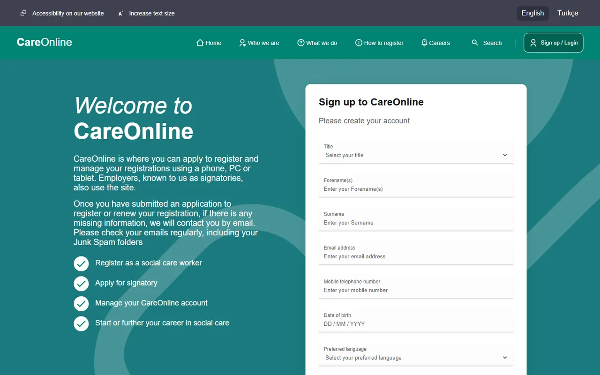

# HTML & CSS Sign-up Page

🇬🇧 English | [🇹🇷 Türkçe](./README.tr.md)

> **Level:** Beginner · **Estimated time:** 1 day · **Tech:** HTML5, CSS3 (Flexbox, Grid)



## 📋 Task

Build a single, static **sign-up page** from the provided Figma design. The page has an accessibility bar at the top, a header with a logo and navigation, and a hero section with an intro text on the left and a sign-up form on the right.

### Requirements

- The page must be **responsive** and adapt to different screen sizes.
- Write **clean, semantic HTML** (`header`, `nav`, `section`, matching `label` + `input`, etc.).
- Stay **as faithful to the design as possible**: colours, spacing and layout.
- Use the **Gibson** typeface (Book, Regular, Medium, SemiBold); **Arial** is accepted as a fallback.
- The form is presentational only: **no** submission or validation is needed.
- Include a short README explaining your approach, assumptions and tech choices.

### Evaluation

Mainly HTML/CSS quality, responsive behaviour and attention to detail.

> ℹ️ The original design file belongs to the company and is not included. The solution code is a faithful implementation of the design and can be used as a reference.

## 💡 Solution

- **Semantic structure:** `header` and `nav` for the top area, `main` and `section` for the content, and a real `<form>` with `label` + `input` pairs (each input has `id` and `name`).
- **CSS Grid** and **Flexbox** are used for layout.
- Spacing and layout are adjusted for mobile, tablet and desktop breakpoints. On mobile the menu icons are hidden and the form goes full width.
- The font stack falls back to Arial when Gibson is not available.
- The form is presentational only, as required, so submitting it does nothing.

## 🚀 Getting started

No installation needed. Just open `index.html` in your browser.

If you use VS Code, you can also open it with the **Live Server** extension.

## 📁 Folder structure

```
├── index.html
├── style.css
└── images/     # icons and logo
```
