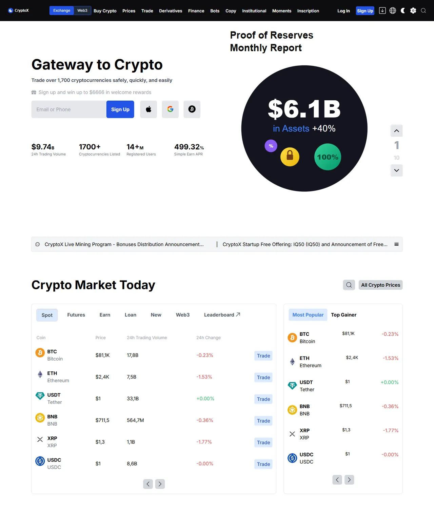

# Crypto Exchange Landing Page Clone

🇬🇧 English | [🇹🇷 Türkçe](./README.tr.md)

> **Level:** Beginner–Intermediate · **Estimated time:** 2–3 days · **Tech:** Next.js 14 (App Router), Tailwind CSS, Swiper, CoinGecko API



> ℹ️ The original task text was not saved, so the task below was reconstructed from the solution code.

## 📋 Task

Build a **pixel-perfect clone** of a popular crypto exchange's home page with Next.js and Tailwind CSS. The market table must be fed by a real API.

### Requirements

- **Header:** Logo, menu links and log in / sign up buttons. It must stay fixed (sticky) while scrolling.
- **Hero:** Headline, sign-up area and an announcements list.
- **Market table:** Name, price, 24h change and volume of the most popular cryptocurrencies, fetched from a crypto API.
- **Events:** A slider of scrollable cards.
- **Startup / airdrop section:** Cards listing new projects.
- **Footer:** Multi-column link list.
- The page must be fully **responsive**.

## 💡 Solution

- Each section is its own component under `app/components` (`Header`, `Hero`, `Table`, `Activities`, `Startup`, `GetStarted`, `Footer`).
- The market table is a **Server Component**; data is fetched on the server from the [CoinGecko API](https://docs.coingecko.com/) (no API key needed) and cached for 60 seconds with `revalidate`. If the API is unavailable, the table shows a message instead of breaking the page.
- The solution originally used the CoinCap v2 API, which has since been shut down; it was switched to CoinGecko so the project keeps working.
- Large numbers are shortened with `millify` (e.g. `1.2B`).
- The events slider uses `swiper`.
- Menu and footer links are kept as arrays in `app/constants` and rendered with `map`.

> The brand name and logo were replaced with a made-up name ("CryptoX") for copyright reasons.

## 🚀 Getting started

```bash
npm install
npm run dev   # http://localhost:3000
```
