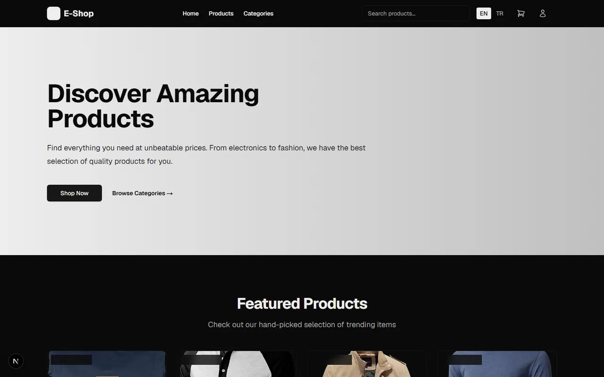

# Multilingual, SEO-Friendly E-Commerce (Next.js)

🇬🇧 English | [🇹🇷 Türkçe](./README.tr.md)

> **Level:** Intermediate–Advanced · **Estimated time:** 7 days · **Tech:** Next.js 15 (App Router), TypeScript, Tailwind CSS, next-intl, Redux Toolkit, ISR/SSG, Fake Store API



## 📋 Task

Build an e-commerce frontend that lists products from the [Fake Store API](https://fakestoreapi.com/), filters them by category, supports **Turkish and English**, and is **SEO-friendly**. High performance, a clean component structure and a professional UI/UX are expected.

### API

- Product list: `GET /products`
- Product detail: `GET /products/:id`

### Functional requirements

1. **Home page:** Featured products (the first 4)
2. **Product list:** Grid layout, price range and category filters, sorting by price (ascending/descending)
3. **Product detail:** Large image, price, description, category and an "Add to cart" button
4. **Cart:** List items, change quantities and remove items
5. **Multi-language:** Turkish and English (`next-intl` or `next-i18next`)
6. **SEO:** Pages generated with SSR/ISR, dynamic `title` and `description` based on the product name
7. **Performance:** Lazy-loaded images with `next/image`, ISR caching, avoiding unnecessary re-renders
8. **UI/UX:** Responsive Tailwind design; reusable components such as `Card`, `Button`, `Layout`, `Header`, `Footer`; visual feedback such as toasts or modals

### Extra evaluation criteria

- Lighthouse scores of 90+ (Performance, SEO, Accessibility)
- Modular, readable code with separated components and layouts
- Daily, meaningful commits

### Delivery

GitHub repo + live demo link (Vercel, Netlify, etc.)

## 💡 Solution

- **Multi-language:** `next-intl` with a `src/app/[locale]/` route structure. Translations live in `messages/tr.json` and `messages/en.json`; locale routing is in `src/middleware.ts`.
- **SEO:** The product detail page uses `generateMetadata` to produce a product-specific title and description.
- **Performance:** API requests are cached with ISR via `revalidate`; images load through `next/image`.
- **State:** The cart is managed with Redux Toolkit (`src/store/slices`).
- **Components:** Grouped under `src/components` as `layout`, `product`, `cart`, `categories` and `ui`.
- Development phases and scope are described in [`PRD.md`](./PRD.md).

## 🚀 Getting started

```bash
npm install
npm run dev   # http://localhost:3000  (/tr or /en)
```
