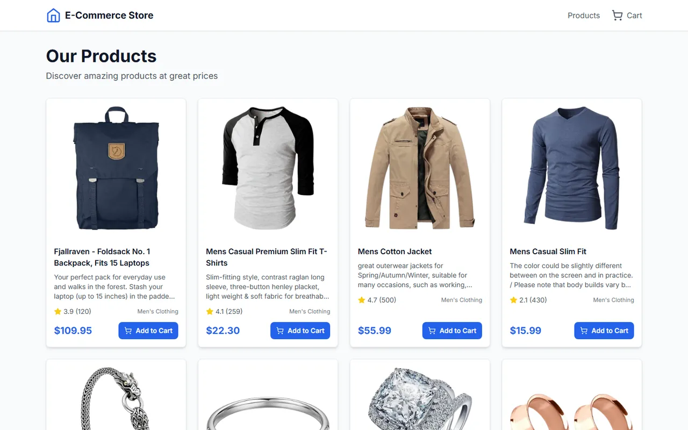

# Microfrontend E-Ticaret (Next.js + Docker)

[🇬🇧 English](./README.md) | 🇹🇷 Türkçe

> **Seviye:** İleri · **Tahmini süre:** 5–7 gün · **Teknolojiler:** Next.js 14 (App Router), TypeScript, Tailwind CSS, Docker, Docker Compose, Fake Store API



> ℹ️ Bu case'in orijinal görev metni kaydedilmediği için aşağıdaki görev tanımı, çözüm kodu incelenerek yeniden yazılmıştır.

## 📋 Görev

Bir e-ticaret sitesini **microfrontend mimarisiyle** iki bağımsız Next.js uygulamasına bölün. Uygulamalar ayrı ayrı geliştirilip çalıştırılabilmeli, ama kullanıcı tek bir site kullanıyormuş gibi hissetmeli.

### Uygulamalar

| Uygulama | Port | Sorumluluk |
|---|---|---|
| **Home** | 3000 | Ürün listesi ve ürün detay sayfaları |
| **Cart** | 3001 | Sepet yönetimi |

### Gereksinimler

- Ürün verileri [Fake Store API](https://fakestoreapi.com/)'den çekilmeli.
- **Home:** Responsive ürün grid'i, ürün detay sayfası, "Sepete ekle" butonu ve bildirim (toast).
- **Cart:** Ürünleri listeleme, adet artırma/azaltma, ürün silme, sepeti temizleme, ara toplam/vergi/toplam özeti ve boş sepet ekranı.
- İki uygulama arasında **sepet durumu senkron** olmalı: Home'da eklenen ürün Cart'ta anında görünmeli.
- İki uygulama ortak tipleri ve servisleri paylaşmalı.
- Her uygulamanın bir `Dockerfile`'ı olmalı ve tüm sistem `docker-compose` ile tek komutla ayağa kalkmalı.
- TypeScript ve Tailwind CSS kullanılmalı.

## 💡 Çözüm

- **Yönlendirme:** Home uygulamasındaki `next.config.js`, `/cart/*` isteklerini `rewrites` ile Cart uygulamasına (3001) yönlendiriyor. Böylece kullanıcı tek bir adres üzerinden iki uygulamayı da kullanıyor.
- **Paylaşılan kod:** `shared/` klasöründe ortak tipler (`types`) ve sepet servisi (`services/CartManager.ts`) bulunuyor.
- **Sepet senkronizasyonu:** `CartManager`, sepeti `localStorage`'da (`e-commerce-cart` anahtarı) tutuyor ve tarayıcının `storage` event'ini dinliyor. İki uygulama farklı portlarda (farklı origin) çalıştığı için `localStorage`'ı paylaşamıyor; kullanıcı uygulamalar arasında geçerken sepet `?cart=` URL parametresiyle taşınıp diğer tarafta kaydediliyor.

> 💡 **Geliştirilebilecek nokta:** Cart uygulaması Home'un adresi altında sunulsaydı (ör. `basePath: '/cart'` + `rewrites`), iki uygulama aynı origin'de olur ve `localStorage`'ı URL parametresine gerek kalmadan paylaşabilirdi. Uygulama adresleri de `localhost` olarak sabit yazılmış; gerçek bir yayında ortam değişkenine taşınması gerekir.
- **Hata toleransı:** Yükleme durumları, hata ekranları ve `localStorage`'a erişilemediğinde güvenli varsayılanlar mevcut.

## 🚀 Çalıştırma

Gereksinimler: Node.js 18+, Docker ve Docker Compose

**Docker ile:**

```bash
docker-compose up --build
```

**Yerel geliştirme:**

```bash
./start-dev.sh
```

veya iki ayrı terminalde:

```bash
cd home && npm install && npm run dev   # http://localhost:3000
cd cart && npm install && npm run dev   # http://localhost:3001
```

## 📁 Klasör yapısı

```
├── home/                # Ürün listesi ve detay uygulaması
├── cart/                # Sepet uygulaması
├── shared/              # Ortak tipler ve CartManager servisi
├── docker-compose.yml
└── start-dev.sh         # İki uygulamayı birlikte başlatan script
```
