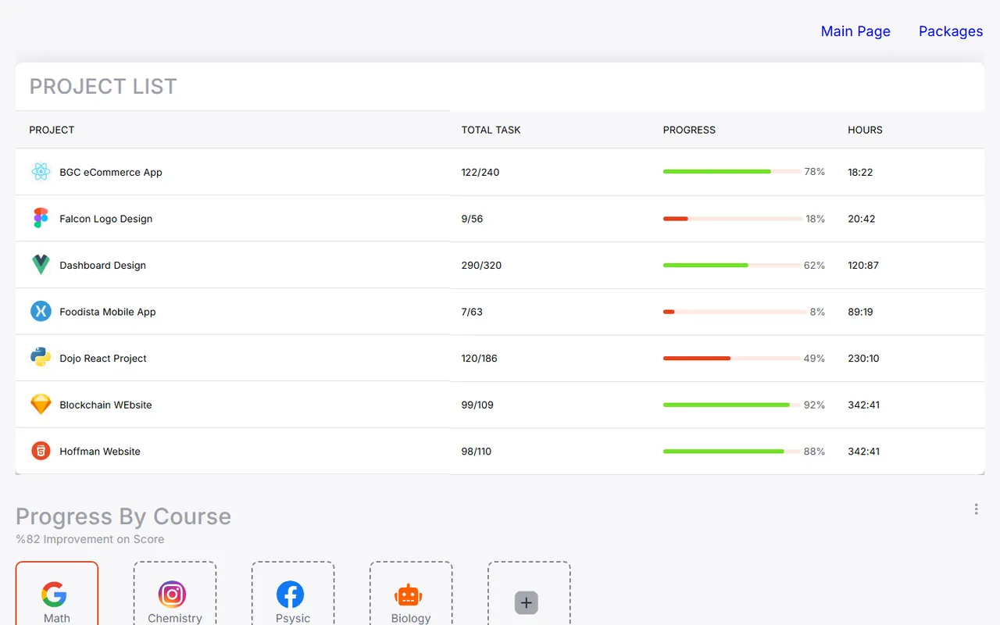

# Learning Platform Dashboard (Next.js + MUI)

🇬🇧 English | [🇹🇷 Türkçe](./README.tr.md)

> **Level:** Intermediate · **Estimated time:** 3–5 days · **Tech:** Next.js (Pages Router), React, TypeScript, Material UI (MUI), Jest, React Testing Library, Cypress



## 📋 Task

Build a web app **similar to the provided Figma design** for an exam-prep / learning platform. As a starting point, the company provides a **template repo** with Next.js, MUI, ESLint, Prettier, Jest and Cypress already set up. The design is a reference: small changes and extra features are fine, but the core features must stay the same.

### Requirements

- Fork the provided template repo and start from there.
- Use **MUI (Material UI)** as the UI library.
- **Functional components and hooks** only (no class components).
- Apply the **React Composition Pattern** for reusable components.
- Material Design Icons may be used for icons.
- **Extra:** Unit tests with Jest + React Testing Library, E2E tests with Cypress (E2E recommended but not required).
- Email the repo link when finished.

### Pages

- **Home:** A project list table with progress bars, lesson cards (Math, Chemistry, Physics, Biology) and a topic-based success table.
- **Packages (`/packages`):** Subscription packages shown as cards.

## 💡 Solution

- Page sections are split into components: `ProjectList`, `LessonCards`, `SecondTable`, `PackageCard`, `ProgressWithLabel`.
- Static data lives in `src/constants` and is rendered with `map`.
- Responsive behaviour uses MUI breakpoints (`theme.breakpoints`) and the `styled` API.
- Theme and layout settings are in `src/configs/themeConfig.ts` and `src/layouts`.

## 🚀 Getting started

```bash
npm install --global yarn@1.22.10   # if needed
yarn
yarn dev        # http://localhost:3030
```

### Tests

```bash
yarn test:watch   # Jest unit tests
yarn e2e          # Cypress E2E tests
```

Unit tests go next to the file under test with a `.test.tsx` extension; E2E tests go under `cypress/e2e/` using the same folder structure.
