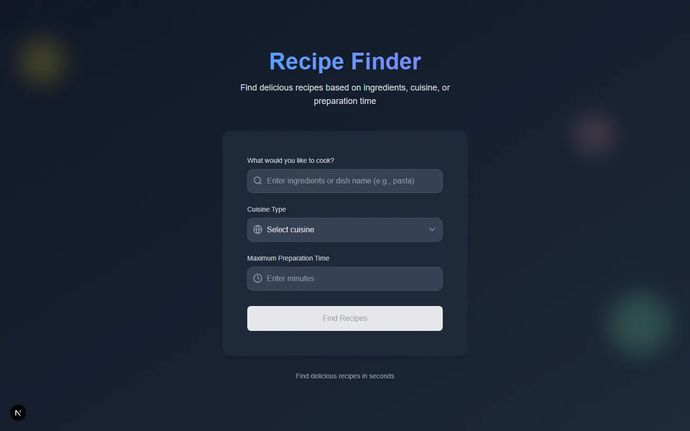

# Tarif Bulucu (Recipe Finder)

[🇬🇧 English](./README.md) | 🇹🇷 Türkçe

> **Seviye:** Başlangıç–Orta · **Tahmini süre:** 2–3 gün · **Teknolojiler:** Next.js 15 (App Router), React 19, TypeScript, Tailwind CSS 4, Spoonacular API



## 📋 Görev

Kullanıcıların filtrelerle tarif arayabildiği, sonuçları ayrı bir sayfada görebildiği ve her tarifin detayına bakabildiği bir **Next.js** uygulaması geliştirin.

### 1. Arama sayfası (ana sayfa)

- Tailwind CSS ile tasarlanmalı; tasarım serbest.
- Form alanları:
  - Tarif araması için metin alanı (**query**, ör. "pasta")
  - Mutfak seçimi için açılır liste (**cuisine**: Italian, Mexican, Chinese vb., en az üç seçenek)
  - Maksimum **hazırlama süresi** (dakika) için sayı alanı
- **"Next"** butonu başta pasif olmalı; üç alandan en az biri doldurulunca aktifleşmeli.
- Butona basılınca seçilen değerler query parametresi olarak `recipes` sayfasına gönderilmeli.

### 2. Tarifler sayfası (`/recipes`)

- Veriler **sunucu tarafında (SSR)** çekilmeli:
  `https://api.spoonacular.com/recipes/complexSearch?query=&cuisine=&maxReadyTime=&apiKey=`
- API yanıtı **1 dakika** önbelleğe alınmalı.
- Her tarifin başlığı ve görseli listelenmeli; tıklanınca `recipes/[id]` sayfasına gidilmeli.
- Veri çekme hataları yönetilmeli.

### 3. Tarif detay sayfası (`/recipes/[id]`)

- `https://api.spoonacular.com/recipes/{id}/information?apiKey=` endpoint'i kullanılmalı.
- **Tarif başlığı** ve **malzeme listesi** gösterilmeli. Hazırlama süresi, porsiyon, özet gibi ek bilgiler opsiyonel.

### 4. Diğer gereksinimler

- Yükleme durumları için React **`Suspense`** kullanılmalı.
- Tüm arayüz Tailwind CSS ile, responsive ve erişilebilir olmalı.
- API key ortam değişkeninde tutulmalı.
- **ESLint** ve **Prettier** kurulmalı.
- README'de kurulum, özellikler ve mimari anlatılmalı.

## 💡 Çözüm

| Dosya | Açıklama |
|---|---|
| `src/app/page.tsx` | Arama formunun bulunduğu ana sayfa |
| `src/app/recipes/page.tsx` | Arama sonuçları (SSR, `revalidate = 60`) |
| `src/app/recipes/[id]/page.tsx` | Tarif detay sayfası |
| `src/services/recipe.service.ts` | Spoonacular API istekleri |
| `src/components/skeletons/` | `Suspense` fallback'leri için skeleton bileşenleri |
| `src/app/error.tsx`, `loading.tsx` | Global hata ve yükleme ekranları |

- Sonuç listesi `Suspense` ile sarıldı; veri gelene kadar skeleton gösteriliyor.
- Önbellek süresi `export const revalidate = 60` ile 1 dakikaya ayarlandı.
- Next.js 15'te `params` ve `searchParams` birer Promise olduğu için sayfalarda `await` ile okunuyor.
- API key sadece sunucuda kullanıldığı için `NEXT_PUBLIC_` öneki olmadan `SPOONACULAR_API_KEY` adıyla tutuluyor; böylece tarayıcı paketine hiç girmiyor.
- API'den gelen tarif özeti HTML içeriyor. `dangerouslySetInnerHTML` ile basmak yerine (XSS riski) etiketler temizlenip düz metin olarak gösteriliyor.
- Form, "Next" butonunun durumunu alanların doluluğuna göre hesaplıyor ve değerleri URL parametresi olarak taşıyor.

## 🚀 Çalıştırma

Gereksinimler: Node.js 18.17+ ve ücretsiz bir [Spoonacular API key](https://spoonacular.com/food-api)

```bash
npm install
cp .env.example .env.local   # API key'inizi girin
npm run dev                  # http://localhost:3000
```

Production build:

```bash
npm run build
npm start
```
