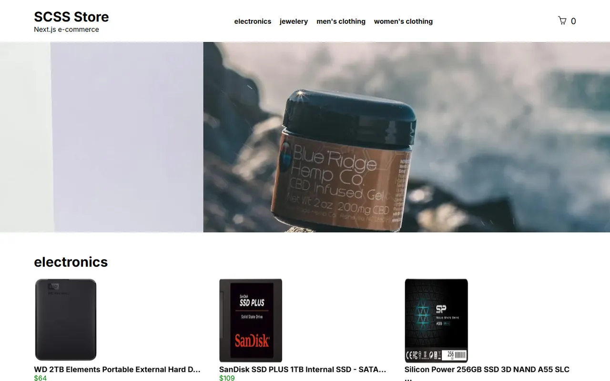

# Next.js + SCSS E-Commerce

🇬🇧 English | [🇹🇷 Türkçe](./README.tr.md)

> **Level:** Beginner–Intermediate · **Estimated time:** 2–3 days · **Tech:** Next.js 14 (App Router), SCSS, Context API, Embla Carousel, React Toastify, Fake Store API



> ℹ️ The original task text was not saved, so the task below was reconstructed from the solution code.

## 📋 Task

Build an e-commerce site with data from the [Fake Store API](https://fakestoreapi.com/), styled with **SCSS**. No Tailwind or UI component libraries.

### Requirements

- **Home page:** An auto-playing slider at the top, followed by product lists / product sliders grouped by category.
- **Category page (`/category/[id]`):** All products in the selected category.
- **Product detail page (`/product/[id]`):** Product image, description, price and an "Add to cart" button.
- **Cart page (`/cart`):** Items in the cart, quantity changes, removal and the total price.
- A header button showing the number of items in the cart.
- The cart must **persist** across page reloads.
- Loading and "page not found" screens.
- Responsive design.

## 💡 Solution

- Data fetching lives in `src/app/utils/api.js`. Pages are **Server Components**, so data is fetched on the server.
- The cart is managed with the **Context API** in `context/basketContext.jsx` and persisted in `localStorage`. Because `localStorage` only exists in the browser, the cart starts empty on the server and is loaded inside a `useEffect` after the page mounts. (The original solution used `useLocalStorage` from `@uidotdev/usehooks`, which crashed during server-side rendering.)
- Cart actions show notifications with `react-toastify`.
- Sliders are built with `embla-carousel-react` and its autoplay plugin.
- Styles are split into `main`, `responsive`, `slide`, `loader` and other partials under `src/app/assets/css`.
- The App Router special files `loading.jsx` and `not-found.jsx` are used.

## 🚀 Getting started

```bash
npm install
npm run dev   # http://localhost:3000
```
