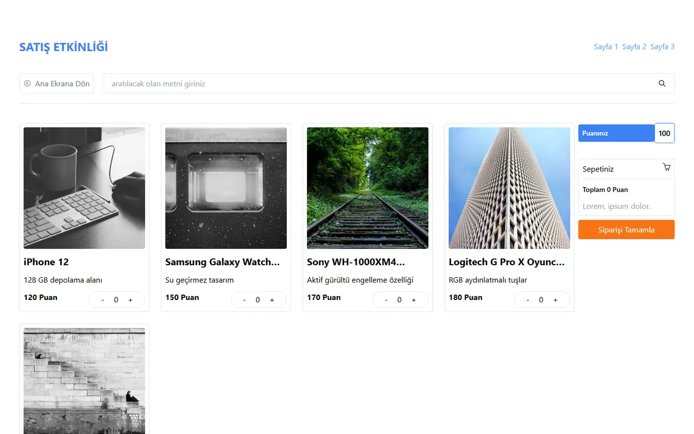

# Campaign & Points-Based Shopping UI

🇬🇧 English | [🇹🇷 Türkçe](./README.tr.md)

> **Level:** Beginner · **Estimated time:** 1–2 days · **Tech:** React 18, Vite, React Router, Tailwind CSS, React Icons



> ℹ️ The original design image contained company logos and is not included. The task below was reconstructed from the design and the solution code.

## 📋 Task

Code the **3-page interface** of a sales campaign site based on the provided wireframe. Placeholders may be used instead of images. No backend is needed, but page 3 should work: search, quantity selection and the points cart.

### Page 1: Home (`/`)

- A horizontal row of round, Instagram-style **story** icons at the top
- A grid of **placeholder boxes** of different sizes in the middle
- A **menu** card on the right with a title and buttons (Settings, Privacy, Security, Profile, Campaigns, Orders) and a placeholder below it

### Page 2: Campaign products (`/page-two`)

- Campaign title (logo) and a **"Back to Home"** button
- A list of product **cards** in the campaign: image, product name, model and how many will be given away
- A small-print legal text box at the bottom describing the campaign terms

### Page 3: Shop with points (`/page-three`)

- "Back to Home" button and a **search** box
- Product cards: image, name, package contents, **points** value and `−` / `+` quantity buttons
- A right column with the user's **points balance**, a **cart summary** (total points) and a **"Complete Order"** button
- On mobile, the right column moves above the products.

## 💡 Solution

- The three pages live in `src/pages`; shared parts are in `src/components`: `Header`, `Stories`, `Menu`, `Card`, `BackButton`.
- Product data is a constant array in `src/constants`, rendered with the `Card` component. `Card` uses an `isPointMode` prop to serve as both the campaign card on page 2 and the points card on page 3.
- **Page 3 logic:**
  - The search box filters products by name as you type.
  - The cart is a `{ productName: quantity }` object in state; the total and remaining points are derived from it on every render instead of being stored separately.
  - The `+` button is disabled when the remaining balance can't cover the product, and `−` is disabled at 0, so the balance can never go negative.
  - "Complete Order" is disabled while the cart is empty.
- The responsive grid uses Tailwind breakpoints. On mobile the cart column is moved to the top with `flex-col-reverse`.

## 🚀 Getting started

```bash
npm install
npm run dev   # http://localhost:5173
```
