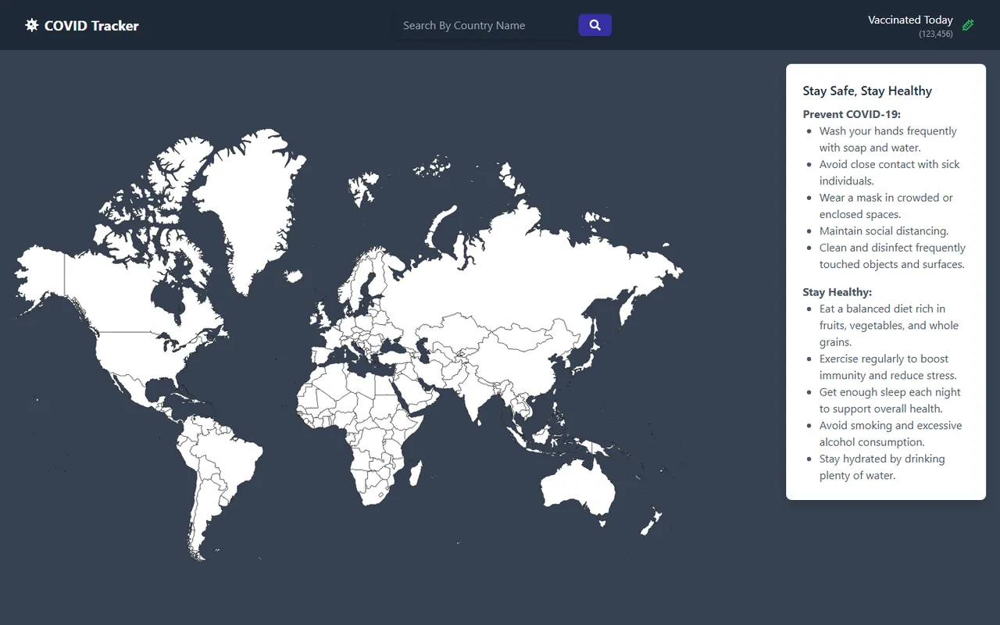

# Covid-19 Dünya Haritası

[🇬🇧 English](./README.md) | 🇹🇷 Türkçe

> **Seviye:** Orta · **Tahmini süre:** 2–3 gün · **Teknolojiler:** React 18, Vite, Redux, Redux-Saga, React Router, Tailwind CSS, Vitest, React Testing Library



> ℹ️ Bu case'in orijinal görev metni kaydedilmediği için aşağıdaki görev tanımı, çözüm kodu incelenerek yeniden yazılmıştır.

## 📋 Görev

Ülkelerin Covid-19 istatistiklerini interaktif bir **dünya haritası** üzerinden gösteren bir uygulama geliştirin. State yönetimi için **Redux + Redux-Saga** kullanılmalı ve uygulama **test** edilmeli.

### Gereksinimler

- **Ana sayfa:** Tıklanabilir bir dünya haritası. Bir ülkeye tıklanınca o ülkenin detay sayfasına gidilmeli.
- **Arama:** Navbar'daki arama kutusuna ülke adı yazılarak da detay sayfasına gidilebilmeli.
- **Detay sayfası (`/detail?country=`):** Ülkenin onaylanmış vaka, ölüm, iyileşen, aktif vaka gibi istatistikleri.
- Veri çekme işlemleri **Redux-Saga** ile yönetilmeli.
- Yükleme ve hata durumları kullanıcıya gösterilmeli.
- Büyük sayılar okunabilir şekilde kısaltılmalı (ör. `1.2M`).
- Detay sayfası için **Vitest + React Testing Library** ile testler yazılmalı (yükleniyor, hata ve veri durumları).

### API'ler

- [Covid-19 Statistics (RapidAPI)](https://rapidapi.com/axisbits-axisbits-default/api/covid-19-statistics): `GET /regions` (ülkeler ve ISO kodları) ve `GET /reports?iso={ISO}`

> İlk çözümde ülke bayrağı da REST Countries v3.1 API'si ile gösteriliyordu; bu API daha sonra kapatıldı.

## 💡 Çözüm

- Harita için `@react-map/world` kullanıldı; seçilen ülke `onSelect` ile, `encodeURIComponent` ile kodlanmış URL parametresi olarak detay sayfasına taşınıyor.
- **Doğru ülkeyi bulmak:** API'nin `q` parametresi bulanık eşleşme yapıyor ("United States" araması ilk sırada Birleşik Arap Emirlikleri'ni döndürüyor). Bu yüzden servis önce `/regions` listesinden ülkenin ISO kodunu buluyor (liste ilk istekten sonra önbellekte tutuluyor; harita ile API arasında farklı olan isimler için eşleme var, ör. "South Korea" → "Korea, South"), ardından `/reports?iso=` isteğini atıyor.
- **Bölgelere ayrılmış ülkeler:** ABD gibi ülkelerde (59 bölge) API her bölge için ayrı satır döndürüyor. Servis bunları toplayarak ülke geneli değerleri hesaplıyor; ölüm oranı da toplamlardan hesaplanıyor.
- `redux/sagas/statisticsSaga.js` isteği çalıştırıp başarı, "veri yok" veya hata action'larını gönderiyor. Ağ hataları yutulmuyor, saga'ya iletiliyor; kullanıcı gerçek hatayı görüyor.
- API istekleri `src/service` ve `src/utils/api.js` içinde. RapidAPI anahtarı ortam değişkeninden okunuyor.
- `DetailPage.test.jsx` içinde `redux-mock-store` ile store taklit edilerek yükleniyor, hata ve başarılı veri durumları test ediliyor.

## 🚀 Çalıştırma

Gereksinim: ücretsiz bir [RapidAPI](https://rapidapi.com/) hesabı ve Covid-19 Statistics API aboneliği

```bash
npm install
cp .env.example .env   # VITE_RAPIDAPI_KEY değerini girin
npm run dev            # http://localhost:5173
npm test               # Vitest
```
