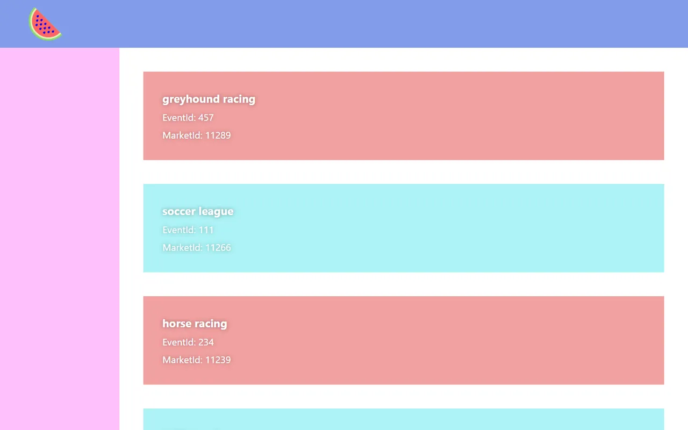

# Displaying Sorted Data with React + Flexbox

🇬🇧 English | [🇹🇷 Türkçe](./README.tr.md)

> **Level:** Beginner · **Estimated time:** 3–4 hours · **Tech:** React 18 (Create React App), CSS Flexbox, Axios



## 📋 Task

Build a single-page React app that transforms and sorts the data in a JSON file and displays it on a page laid out with **Flexbox**.

The provided files are in the [`case/`](./case) folder:

| File | Description |
|---|---|
| [`testData.json`](./case/testData.json) | Data with sport and market information |
| [`mockup.png`](./case/mockup.png) | Page layout: 1 = header, 2 = left menu, 3 = data boxes |
| [`melon.svg`](./case/melon.svg) | SVG image to add to the header |

### Requirements

1. Create a project with `npx create-react-app`.
2. Transform the `testData.json` data:
   - Convert the `sportName` values to **lower case**.
   - Sort the array by `marketId` from **highest to lowest**.
3. Build the layout in `mockup.png`, including its background colours, using **Flexbox**.
4. Show the sorted data in the boxes numbered "3", in a design of your choice.
5. Create a mobile layout starting at **375px** width:
   - On mobile, the order of the "3" boxes must be reversed **using only CSS** (`marketId` lowest to highest).
   - The left section (number 2) must be hidden on mobile.
6. Use at least one **pseudo-element** (`::before` / `::after`) and one **pseudo-class** (`:hover`, etc.) anywhere in the layout.
7. Add the SVG to the header and change the colour of all the **seeds to blue**.

## 💡 Solution

- The data is fetched from `public/testData.json` with `axios`, flattened with `map`, `sportName` is lower-cased, and the array is sorted by `marketId` in descending order with `sort`.
- No JavaScript is used for the reversed mobile order; `flex-direction: column-reverse` is applied to `main`.
- `::selection` is used as the pseudo-element and `:nth-child(odd/even)` as the pseudo-class (to colour the boxes alternately).
- The SVG is imported as a component with CRA's `ReactComponent` import, so the seed colour can be changed with `fill: blue` in CSS.
- A loading animation is shown while the data loads.

## 🚀 Getting started

```bash
npm install
npm start   # http://localhost:3000
```
