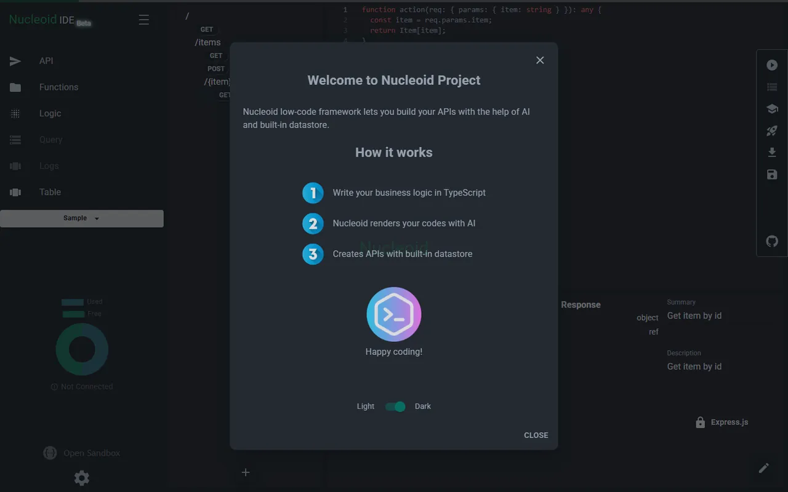

# Working on an Existing Project: Web-Based IDE

🇬🇧 English | [🇹🇷 Türkçe](./README.tr.md)

> **Level:** Intermediate–Advanced · **Estimated time:** 2–4 days · **Tech:** React 18, Vite, Material UI, Monaco Editor, React Flow, Jest, Cypress



> ℹ️ The original task text was not saved, so the task below was reconstructed from the solution code.

## 📋 Task

This case is different from the others: instead of building a project from scratch, you join a **large, real open-source codebase** and develop on top of it. The project is a web-based IDE for low-code backend development ([Nucleoid IDE](https://github.com/NucleoidAI/IDE), Apache-2.0 licensed).

This is the most common situation when you start a real job: reading and understanding a project with hundreds of files written by someone else, and making changes without breaking the existing structure.

### Expectations

- Run the project locally and study its folder structure, state management and component architecture.
- Add the requested feature or fix **in line with the existing code style and architecture**.
- Write **Jest** unit tests for the utility functions (`src/utils`).
- Don't break the existing lint, test and CI rules.

### What is evaluated?

- Reusing existing components and helpers instead of rewriting them
- Small, focused changes (no unnecessary refactoring)
- Meaningful commit messages

## 💡 Solution

- `src/utils/test/` contains Jest tests for the `DeepCopy`, `Map` and `Path` helpers. For example, the `DeepCopy` test checks that the copy is independent of the original (changing nested fields does not affect the copy).
- UI changes were made using MUI components and the project's own widget structure (`src/widgets`, `src/components`).

## 🚀 Getting started

```bash
npm install
cp .env.example .env
npm run dev   # Vite dev server
npm test      # Jest tests
```

## 📄 License

The code in this folder is licensed under the original project's [Apache License 2.0](./LICENSE).
