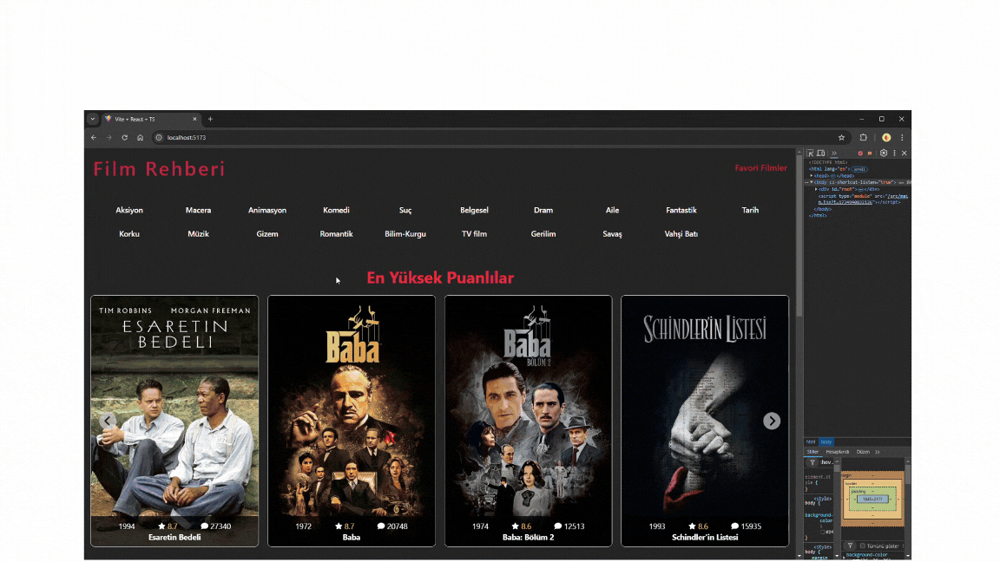

# Movie Guide (TMDB)

🇬🇧 English | [🇹🇷 Türkçe](./README.tr.md)

> **Level:** Intermediate · **Estimated time:** 7 days · **Tech:** React 18, Vite, TypeScript, Redux Toolkit, RTK Query, Tailwind CSS, React Router, TMDB API

## 📋 Task

Build a movie guide app using the [The Movie Database (TMDB)](https://developer.themoviedb.org/) API.

### Requirements

- **Home page:** Show the **Top Rated**, **Popular** and **Trending** movie categories.
- **Detail page:** Each movie has its own detail page.
- **Favorites page:** Users can add/remove movies to/from favorites and view their favorites.
- Use **TypeScript**, **Redux Toolkit Query** and **Tailwind CSS**.
- The codebase must be well structured and follow best practices.
- Deadline: **1 week**

## 💡 Solution

- All API requests are defined with **RTK Query** in `src/features/movieApi.ts`. Caching and loading states are handled by RTK Query.
- Favorites are kept in Redux with `favoritesSlice`. The reducers are pure (adding the same movie twice is ignored); `store.ts` writes the list to `localStorage` with `store.subscribe`, so favorites survive page reloads.
- Movie lists are shown as sliders with `react-splide`.
- Trailers play with `react-player`; large numbers such as vote counts are shortened with `millify`.
- Skeleton components for loading states live under `src/pages/loading`.
- Image URLs and sizes are centralized in `src/constant.ts`.
- `npm run build` runs `tsc` before `vite build`, so type errors stop the build.

### Pages

| Route | Page |
|---|---|
| `/` | Top Rated, Popular and Trending lists |
| `/movie/:id` | Movie details: cast, reviews, trailer |
| `/favorites` | Favorite movies |



## 🚀 Getting started

Requirements: a free [TMDB](https://www.themoviedb.org/) account and an **API Read Access Token**

```bash
npm install
cp .env.example .env   # set VITE_TMDB_API_KEY
npm run dev            # http://localhost:5173
```
