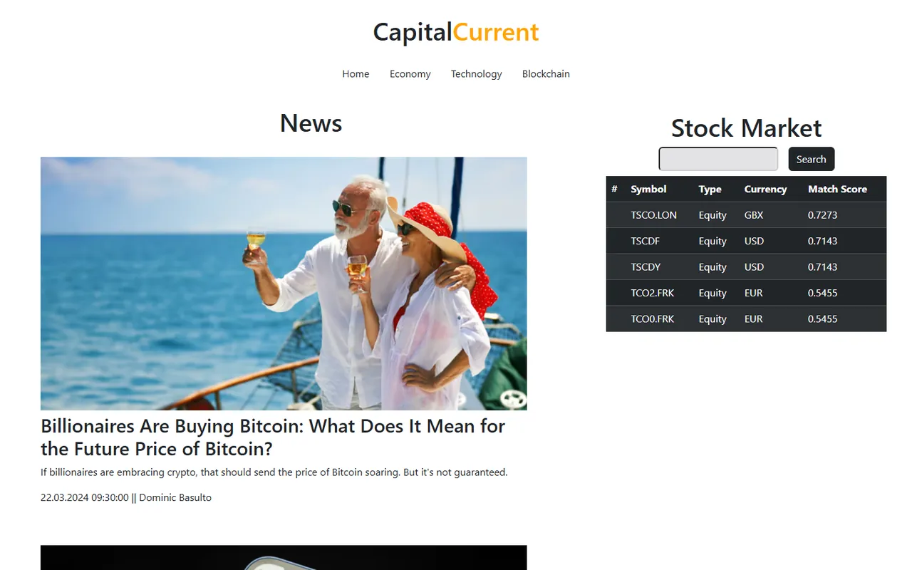

# Finans Haberleri & Hisse Takip Paneli

[🇬🇧 English](./README.md) | 🇹🇷 Türkçe

> **Seviye:** Başlangıç–Orta · **Tahmini süre:** 2–3 gün · **Teknolojiler:** React 18, Vite, React Router, Bootstrap, Axios, json-server, React Paginate



> ℹ️ Bu case'in orijinal görev metni kaydedilmediği için aşağıdaki görev tanımı, çözüm kodu incelenerek yeniden yazılmıştır.

## 📋 Görev

Finans haberlerini ve hisse/kripto arama sonuçlarını gösteren bir haber sitesi arayüzü geliştirin. Veriler [Alpha Vantage](https://www.alphavantage.co/) API'sinin formatındadır (`NEWS_SENTIMENT` ve `SYMBOL_SEARCH`).

### Gereksinimler

- **Header:** Site adı ve kategori menüsü (Home, Economy, Technology, Blockchain). Aktif kategori vurgulanmalı.
- **Haber listesi:** Görsel, başlık, özet, yazar ve yayın tarihi içeren kartlar. **Sayfalama** (pagination) olmalı.
- **Haber detayı (`/newsDetail/:id`):** Haberin tamamı ve kaynağa giden link.
- **Hisse paneli:** Sembol listesi ve sembole göre **arama** yapılabilen bir yan panel.
- Responsive tasarım (Bootstrap grid).

## 💡 Çözüm

- Ücretsiz API'nin istek limiti düşük olduğu için örnek API yanıtları `db.json` dosyasına kaydedildi ve **json-server** ile lokal bir REST API olarak sunuldu (`/feed`, `/matches`).
- Haber listesi `react-paginate` ile sayfalandı.
- Hisse araması, önceden çekilen liste üzerinde istemci tarafında filtreleme yapıyor.
- Alpha Vantage'a doğrudan istek atan kod `src/constant.js` içinde yorum satırı olarak duruyor; kendi API key'inizle canlı veriye geçebilirsiniz.

## 🚀 Çalıştırma

İki ayrı terminalde:

```bash
npm install
npm run server   # json-server → http://localhost:3050
npm run dev      # http://localhost:5173
```

Canlı API kullanmak isterseniz [Alpha Vantage](https://www.alphavantage.co/support/#api-key)'dan ücretsiz key alıp `src/.env.example` dosyasını `.env` olarak kopyalayın.
