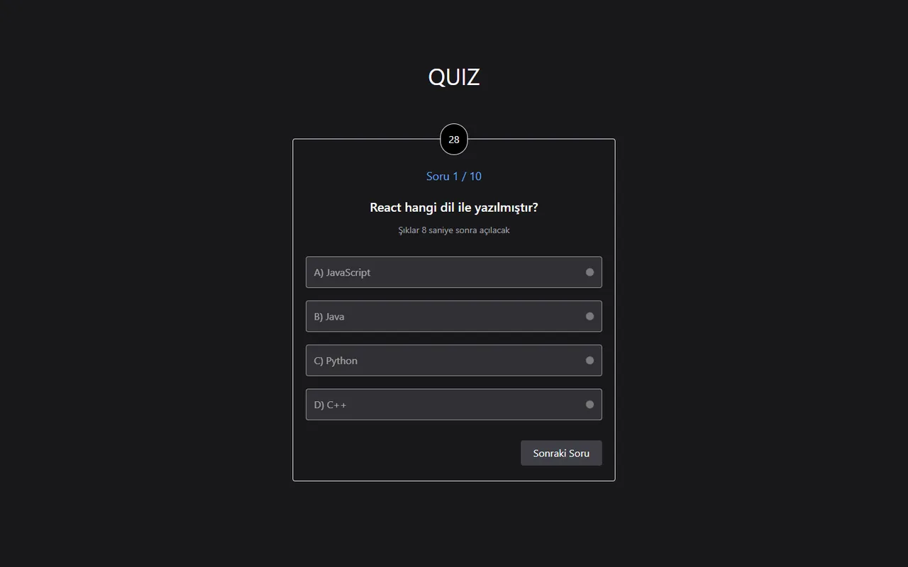

# Süreli Quiz Uygulaması

[🇬🇧 English](./README.md) | 🇹🇷 Türkçe

> **Seviye:** Başlangıç · **Tahmini süre:** 1 gün · **Teknolojiler:** React 18, Vite, Tailwind CSS, Axios



> ℹ️ Bu case'in orijinal görev metni kaydedilmediği için aşağıdaki görev tanımı, çözüm kodu incelenerek yeniden yazılmıştır.

## 📋 Görev

Soruların sırayla ve **süreli** olarak gösterildiği bir quiz uygulaması geliştirin.

### Gereksinimler

- Sorular bir JSON kaynağından çekilmeli. Her soruda metin, 4 şık (A–D) ve doğru cevap bulunuyor.
- Ekranda aynı anda **tek bir soru** gösterilmeli.
- Her soru için bir **geri sayım sayacı** olmalı (ör. 30 saniye):
  - Sorunun ilk saniyelerinde şıklar **kilitli** olmalı; kullanıcı önce soruyu okumalı.
  - Süre bitince cevap verilmese bile otomatik olarak sonraki soruya geçilmeli.
- Kullanıcının seçtiği cevaplar kaydedilmeli.
- Quiz bitince her soru için **verilen cevap**, **doğru cevap** ve **doğru/yanlış** durumunu gösteren bir sonuç tablosu gösterilmeli.

## 💡 Çözüm

- Sorular `public/db.json` dosyasından `axios` ile çekiliyor.
- Süreler iki sabitle yönetiliyor: `QUESTION_TIME = 30` ve `LOCK_TIME = 10`. Şıklar ilk 10 saniye kilitli kalıyor ve kaç saniye kaldığı ekranda yazıyor.
- Sayaç `useEffect`'i her soru değiştiğinde süreyi sıfırlıyor ve cleanup fonksiyonunda interval'i temizliyor. İkinci bir effect `timeLeft`'i izliyor ve süre 0 olunca sonraki soruya geçiyor; böylece state güncelleme fonksiyonunun içinde yan etki çalışmıyor.
- Radio butonlar state ile kontrol ediliyor (`checked`); DOM ref'ine veya form sıfırlamaya gerek kalmıyor. Kilitli şıklar seçilemiyor.
- Cevap seçildikten sonra kullanıcı "Sonraki Soru" butonuyla süreyi beklemeden ilerleyebiliyor.
- Cevaplar soru numarasıyla saklanıyor; sonuç tablosu her cevabı kendi sorusuyla eşleştiriyor, boş bırakılan sorular sonuçları kaydırmıyor.

## 🚀 Çalıştırma

```bash
npm install
npm run dev   # http://localhost:5173
```
