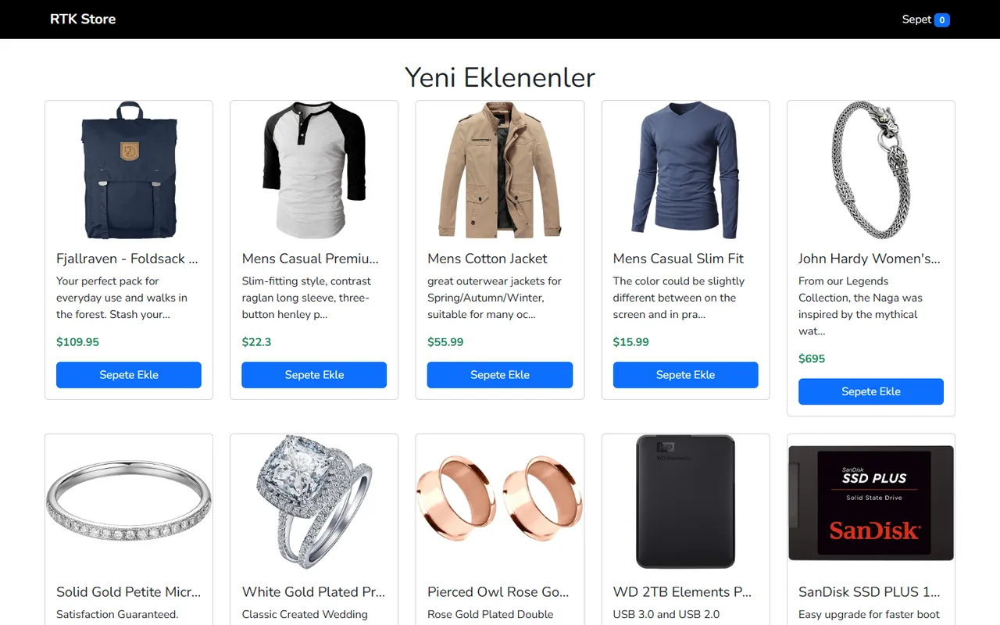

# Redux Toolkit Query ile E-Ticaret

[🇬🇧 English](./README.md) | 🇹🇷 Türkçe

> **Seviye:** Başlangıç–Orta · **Tahmini süre:** 1–2 gün · **Teknolojiler:** React 18, Vite, Redux Toolkit, RTK Query, React Router, React Bootstrap, React Toastify, Fake Store API



> ℹ️ Bu case'in orijinal görev metni kaydedilmediği için aşağıdaki görev tanımı, çözüm kodu incelenerek yeniden yazılmıştır.

## 📋 Görev

[Fake Store API](https://fakestoreapi.com/) ile ürünleri listeleyen ve sepet yönetimi yapan bir e-ticaret uygulaması geliştirin. Veri çekme için **RTK Query**, sepet için **Redux Toolkit slice** kullanılmalı.

### Gereksinimler

- **Ana sayfa (`/`):** Ürünlerin kartlar hâlinde listesi (görsel, başlık, fiyat, "Sepete ekle" butonu).
- **Sepet sayfası (`/cart`):** Sepetteki ürünler, adet artırma/azaltma, ürün silme, sepeti temizleme ve toplam tutar.
- Header'da sepetteki toplam ürün sayısı görünmeli.
- Sepet **sayfa yenilense de** korunmalı.
- Sepet işlemlerinde kullanıcıya bildirim (toast) gösterilmeli.
- Olmayan bir sayfaya gidilince 404 sayfası gösterilmeli.

## 💡 Çözüm

- `src/redux/query/productsApi.js`: `createApi` ve `fetchBaseQuery` ile ürün endpoint'i tanımlandı; bileşenlerde `useGetProductsQuery` hook'u ile yükleme, hata ve veri durumları alınıyor.
- `src/redux/slices/cartSlice.js`: Sepete ekleme, adet azaltma, silme, temizleme ve toplam hesaplama reducer'ları. Sepet her değişiklikte `localStorage`'a yazılıyor ve başlangıçta oradan okunuyor.
- Bildirimler reducer içinden `react-toastify` ile gösteriliyor.
- Arayüz React Bootstrap bileşenleriyle hazırlandı.

## 🚀 Çalıştırma

```bash
npm install
npm run dev   # http://localhost:5173
```
