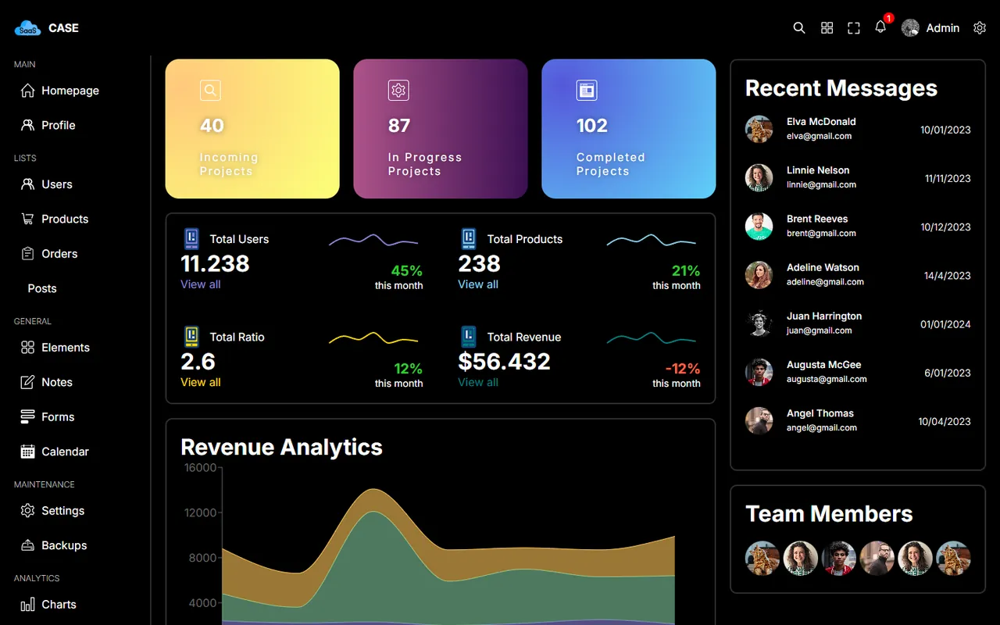

# SaaS Admin Dashboard

[🇬🇧 English](./README.md) | 🇹🇷 Türkçe

> **Seviye:** Orta · **Tahmini süre:** 3–5 gün · **Teknolojiler:** React 18, Vite, TypeScript, SCSS, Material UI, MUI Data Grid, Recharts, Framer Motion, React Router



## 📋 Görev

Size gönderilen bir ekran kaydında (GIF) gösterilen **SaaS müşteri paneli (dashboard)** arayüzünü ve etkileşimlerini, **olabildiğince birebir** kopyalayın.

### Gereksinimler

1. GIF'teki arayüzü ve etkileşimi inceleyin.
2. İstediğiniz frontend teknolojisini kullanın (React, Vue, Angular vb.).
3. **Piksel piksel** doğruluğu hedefleyin.
4. **Animasyonlar, geçişler ve responsive davranış** gibi detaylara dikkat edin.
5. Projeyi bir platformda yayınlayıp **canlı demo** linki verin.
6. Kodu private bir GitHub reposunda paylaşın.

### Değerlendirme

- Kullanıcı dostu ve görsel olarak çekici bir dashboard tasarımı
- Fonksiyonellik ve farklı cihazlarda responsive davranış
- Kullanıcı deneyimini iyileştiren animasyonlar
- Kod kalitesi, açık kullanım talimatları ve temiz tasarım

> ℹ️ Görevde verilen GIF dosyası repoya eklenmemiştir.

## 💡 Çözüm

- **Layout:** `Navbar`, sol `Menu`, içerik alanı ve `Footer`. Rotalar `createBrowserRouter` ile tanımlandı (`/` ve `/users/:id`).
- **Ana sayfa:** CSS Grid ile kutulara bölünmüş bir dashboard:
  - `TopBox`: son mesajlar listesi
  - `ChartBox`: toplam kullanıcı, ürün, gelir ve oran için küçük çizgi grafikler
  - `BigChartBox`: gelir analizi (Revenue Analytics) alan grafiği
  - `PieChartBox`: kaynaklara göre potansiyel müşteri dağılımı
  - `BarChartBox`: toplam ziyaret ve kâr grafikleri
- Grafikler **Recharts**, tablolar **MUI Data Grid** ile yapıldı.
- `Members` bileşeninde **Framer Motion** ile sıralı giriş animasyonları var.
- Responsive kırılımlar `styles/responsive.scss` içinde mixin olarak tanımlandı; renkler `styles/variables.scss` içinde.
- Örnek veriler `src/data.ts` dosyasında.

## 🚀 Çalıştırma

```bash
npm install
npm run dev   # http://localhost:5173
```
