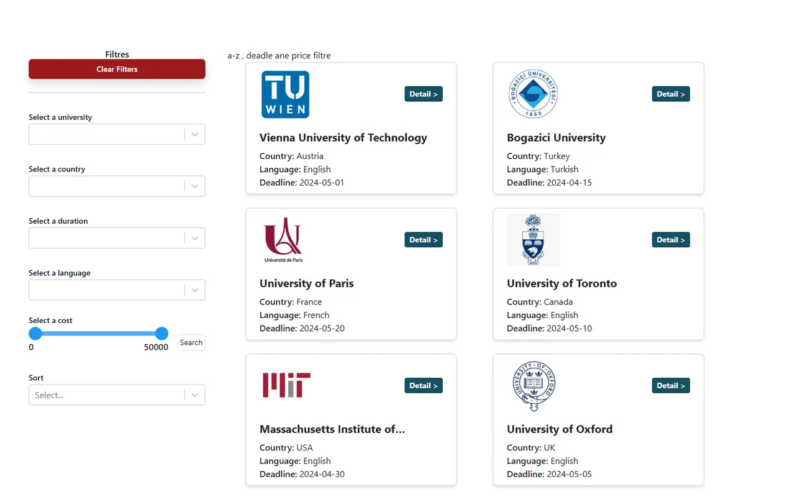

# Üniversite Listesi: Filtreleme, Sayfalama ve Giriş

[🇬🇧 English](./README.md) | 🇹🇷 Türkçe

> **Seviye:** Orta · **Tahmini süre:** 3–4 gün · **Teknolojiler:** React 18, Vite, React Router, Context API, Tailwind CSS, Axios, json-server



> ℹ️ Bu case'in orijinal görev metni kaydedilmediği için aşağıdaki görev tanımı, çözüm kodu incelenerek yeniden yazılmıştır.

## 📋 Görev

Yurt dışında eğitim almak isteyen öğrenciler için, üniversite programlarının listelendiği ve detaylı filtrelenebildiği bir uygulama geliştirin. Uygulamaya sadece kayıtlı kullanıcılar girebilmeli.

### Gereksinimler

**Kimlik doğrulama**
- **Kayıt sayfası (`/register`):** Ad, e-posta ve şifre ile kayıt. Aynı e-posta ile ikinci kez kayıt olunamamalı.
- **Giriş sayfası (`/`):** E-posta ve şifre kontrolü; başarılı girişte listeye yönlendirme.

**Liste (`/main`)**
- Üniversite kartları: logo, ad, ülke, süre, dil ve ücret.
- Yan panelde filtreler:
  - Üniversite, ülke, süre ve dil için açılır listeler
  - Ücret için **aralık (range) slider**
  - Sıralama seçenekleri (ör. ücrete göre artan/azalan)
  - "Filtreleri temizle" butonu
- **Sayfalama** (pagination)
- Filtre, sıralama ve sayfa bilgisi **URL'de** tutulmalı.

**Detay (`/main/:id`)**
- Seçilen üniversitenin tüm bilgileri.

**Diğer**
- Yükleme, hata ve 404 sayfaları.

## 💡 Çözüm

- Backend olarak **json-server** kullanıldı; veriler `db.json` içinde (`universities`, `users`).
- Filtreleme, sıralama ve sayfalama işi tamamen json-server'ın sorgu parametrelerine bırakıldı: `country=`, `cost_gte=`, `cost_lte=`, `_sort=`, `_order=`, `_page=`, `_limit=`. Toplam kayıt sayısı `X-Total-Count` header'ından okunuyor.
- Tüm filtre değerleri `useSearchParams` ile URL'de tutuluyor. Filtre değişince sayfa 1'e dönülüyor.
- Liste verisi `UniversityContext` ile yönetiliyor.
- Açılır listelerin seçenekleri, veriden tekrar edenler temizlenerek oluşturuluyor (`utils/removeDuplicates.js`).
- Kütüphaneler: `react-select`, `react-range-slider-input`, `react-paginate`.

## 🚀 Çalıştırma

İki ayrı terminalde:

```bash
npm install
npm run server   # json-server → http://localhost:3000
npm run dev      # http://localhost:5173
```

Demo giriş bilgileri: `demo@example.com` / `password1`
