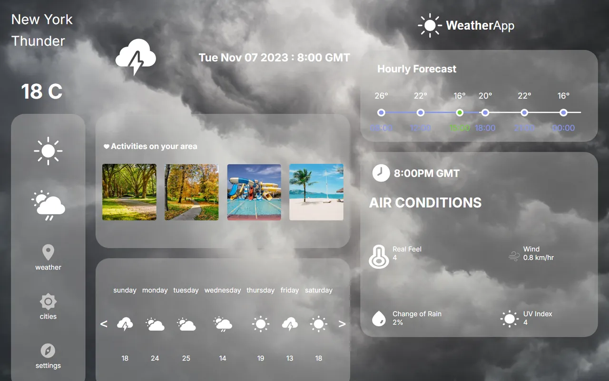

# Hava Durumu Dashboard Arayüzü

[🇬🇧 English](./README.md) | 🇹🇷 Türkçe

> **Seviye:** Başlangıç · **Tahmini süre:** 1–2 gün · **Teknolojiler:** React 18, Vite, SCSS, Swiper



> ℹ️ Bu case'in orijinal görev metni kaydedilmediği için aşağıdaki görev tanımı, çözüm kodu incelenerek yeniden yazılmıştır.

## 📋 Görev

Verilen tasarıma göre bir **hava durumu paneli** arayüzü kodlayın. Veriler hazır bir JSON dosyasından okunacak; gerçek bir API'ye bağlanmak gerekmiyor. Odak noktası **bileşenlere ayırma** ve **SCSS ile birebir tasarım**.

### Gereksinimler

Sayfa iki kolondan oluşuyor:

**Sol kolon**
- Şehir adı, güncel sıcaklık, hava tipi ve tarih
- Sol menü: Weather, Cities, Settings
- "Bölgenizdeki aktiviteler" başlıklı görsel kartlar
- Yatay kaydırılabilir (slider) kartlar

**Sağ kolon**
- Logo
- **Saatlik tahmin:** Gün içindeki saatlere göre sıcaklıklar
- **Hava koşulları:** Hissedilen sıcaklık, rüzgâr, yağış ihtimali, UV indeksi
- Haftalık hava durumu

Veriler `src/db.json` dosyasından okunmalı.

## 💡 Çözüm

- Tasarım, her biri kendi `index.jsx` ve `.scss` dosyasına sahip altı bileşene bölündü (`Component0` … `Component5`).
- Veriler `db.json`'dan doğrudan import ediliyor (`import data from "../../db.json"`), ayrı bir istek atılmıyor.
- Haftalık hava durumu kartları için `swiper` kullanıldı.
- Ana yerleşim `container-left` / `container-right` olarak Flexbox ile kuruldu.

## 🚀 Çalıştırma

```bash
npm install
npm run dev   # http://localhost:5173
```
